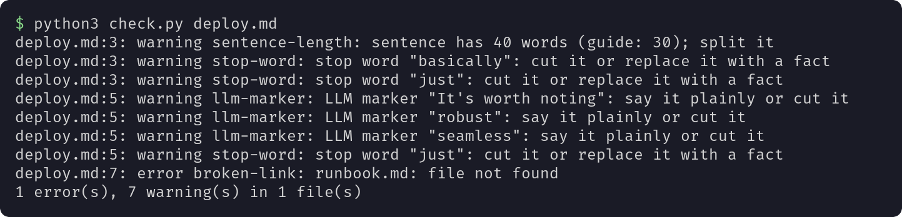
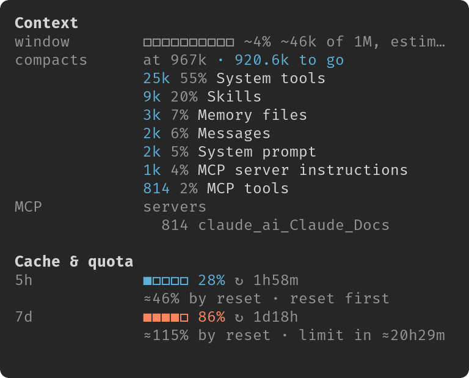

# claude-skills

[](https://github.com/VizzleTF/claude-skills/actions/workflows/ci.yml)

Four Claude Code plugins in the marketplace `vizzletf-skills`. They make Claude write documentation by type, show context and quota above the prompt, and keep replies and code changes short.

| Plugin | What you get | Needs |
|---|---|---|
| [technical-writing](#technical-writing) | A README, runbook, ADR, changelog or one of 9 other document types, built for its reader, in English or Russian | Python 3 for the text checker |
| [tidemark](#tidemark) | Context fill, quota with time to reset, prompt cache, model and git in a clickable band above the prompt, also in the desktop app | Claude Code 2.1.288 or later |
| [vi-voice](#vi-voice) | Replies that open with the answer and fit in 5 lines; code and errors quoted exactly | — |
| [vi-code](#vi-code) | Claude reuses the code you have, updates every place a change must reach, and proves a bug's cause before fixing it | — |

## Install

Add the marketplace once, then install the plugins you want:

```
/plugin marketplace add VizzleTF/claude-skills
/plugin install technical-writing@vizzletf-skills
/plugin install tidemark@vizzletf-skills
/plugin install vi-voice@vizzletf-skills
/plugin install vi-code@vizzletf-skills
```

## technical-writing

Ask Claude `Write a runbook for the alert QueueWorkerDown`, or run `/technical-writing:runbook alert QueueWorkerDown`. You get a runbook with impact, diagnosis, an action and a verification command for each step, and escalation. A plain request to Claude gives a generic page; the skill first decides who reads the document and in what state, then picks the matching type and its required sections.

On 28 test scenarios its documents came out 20–30% shorter than those of the earlier `writing-docs` skill. Opus scored each pair blind on a 1–5 rubric, and the shorter documents got the same score or higher.

The bundled checker flags long sentences, stop words, LLM markers and broken links in any Markdown file:

```sh
python3 plugins/technical-writing/skills/write/scripts/check.py deploy.md
```



All 13 commands and uninstall: [technical-writing README](plugins/technical-writing/README.md).

## tidemark

tidemark is a mod, a plugin that draws in the Claude Code interface. It draws a band of widgets above the prompt, in the terminal and in the desktop app's Code tab. It does not take your `statusLine`, so a status line script keeps working beside it. Press a widget to switch the model or effort, open `/usage` or run `/compact`. The band appears right after the install. If it does not, run `/reload-plugins`.


`/tidemark` opens a details pane with the context breakdown, quota forecast and subagents. `/tidemark-config` edits the widgets with a live preview.



Widgets, config, privacy and uninstall: [tidemark README](plugins/tidemark/README.md).

## vi-voice

Claude opens each reply with the answer or result and keeps the body to 5 lines. Greetings, recaps and closing offers go; caveats, numbers and next steps stay. The reply ends with what was not checked and what is left to do. On 20 test questions an early version answered in 187 words (median), against 221 and 268 for two other reply-style plugins. Its accuracy score matched the better of them. Details and the measurement: [vi-voice README](plugins/vi-voice/README.md).

## vi-code

Claude reads the code before editing, reuses what the codebase has and adds no options or abstractions nobody asked for. It keeps validation at trust boundaries, that is where outside input enters, and changes every caller. A bug gets its cause proven before the fix. The rules also reach every subagent and cost about 350 words of context. Details: [vi-code README](plugins/vi-code/README.md).

## Links

- [README на русском](README.ru.md)
- [Contributing](CONTRIBUTING.md)
- License: [MIT](LICENSE)
