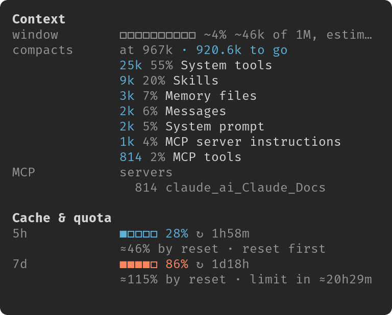

# tidemark

A band of widgets above the Claude Code prompt, in the terminal and the desktop app.

- how full the context is and when the prompt cache expires
- 5-hour and weekly quota with time to reset
- model, reasoning effort and git branch
- press a widget to switch the model or effort, open `/usage` or `/context`, or run `/compact`
- `/tidemark` shows what fills the context and when the quota runs out
- `/tidemark-config` edits the band with a live preview and presets
- the desktop app can have its own band layout
- works beside your `statusLine`, changes no settings; no telemetry

Needs Claude Code 2.1.288 or later.

```
/plugin marketplace add VizzleTF/claude-skills
/plugin install tidemark@vizzletf-skills
```

The band appears right after the install. If it does not, run `/reload-plugins`.


## Contents

- [Commands](#commands)
- [Widgets](#widgets)
- [Configure](#configure)
- [Uninstall](#uninstall)
- [What it runs, reads and writes](#what-it-runs-reads-and-writes)
- [Links](#links)

## Commands

| Command | Opens |
|---|---|
| `/tidemark` | Details pane: context by source, cache and quota with a forecast to reset, the session and its subagents |
| `/tidemark-config` | Config editor with a live preview |
| `/tidemark-goal [text]` | Sets the session goal the `goal` widget shows |
| `/tidemark-project [text]` | Sets the project name the `project` widget shows |



## Widgets

The **Default** column marks the widgets of the band you get without a config file. Some of them stay hidden until they have something to show.

| Widget | Shows | Default |
|---|---|---|
| `context` | `ctx` bar, percent, `used/window`, growth sparkline | ✓ |
| `cache` | `warm 38m`, `cold`, `rewrote 45k` | ✓ |
| `quota5h` | `5h 42% ↻ 2h34m` | ✓ |
| `quota7d` | `7d 63% ↻ 2d7h` | ✓ |
| `model` | `opus 5.5 · high`; a press switches the model or the effort | ✓ |
| `git` | branch, `*` for uncommitted changes, sync with the upstream, `+12 −3` | ✓ |
| `goal` | text from `/tidemark-goal`; hidden until set | |
| `project` | text from `/tidemark-project`; hidden until set | ✓ |
| `compact` | a `/compact` button | ✓ |
| `actions` | a `⚙` button that opens `/tidemark-config` | ✓ |
| `flex` | nothing; splits the row into groups: left, middle, right | ✓ |
| `cost` | `≈$1.84 (+$0.12)`: the session and the current turn | |
| `agents` | a spinner per running subagent | |
| `cwd` | project name, directory name or path | ✓ |
| `sessionTime` | `⏱ 1h12m` since the conversation started | ✓ |
| `compactions` | `⇣2` | |
| `tokenSpeed` | `42 t/s` for the last turn | |
| `command` | the first line of your command's output | |
| `claudeStatus` | `● ok` … `● critical` from status.claude.com | |
| `gitPr` | `#123 ✓` for the branch's PR or MR; needs `gh` or `glab` | |

The prompt cache keeps the conversation for 5 minutes or an hour after each request. `warm 38m` is the time left; after it, the next request is `cold` and writes the whole context to the cache again, which costs more. A `◆` after a quota percent means you use it faster than its window passes.

The default band uses Nerd Font icons; without such a font in the terminal, set `style.icons` to `text`. The desktop app draws text labels and can have its own band: the `desktop` key in the [reference](docs/reference.md#config-keys). Figures are coloured from blue to red by the used share. Options of each widget: [Reference](docs/reference.md#widgets).

## Configure

No config file is needed. To change the widgets, run `/tidemark-config`, edit the band in the preview, pick a file in the `save to` field and press `Save`:

| `save to` | File |
|---|---|
| `global` | `~/.config/tidemark/config.json` |
| `project` | `.claude/tidemark.json` in the session's directory; overrides `global` |

The editor also offers presets: `minimal`, `classic`, `default`, `full` (two rows) and `powerline`. Once the context reaches 70% of the window, the `/compact` button appears under the band; `compact.at` sets the threshold.

## Uninstall

```
/plugin uninstall tidemark@vizzletf-skills
```

The config files and project notes stay. To remove them, delete `~/.config/tidemark/`, `.claude/tidemark.json` and `.claude/tidemark-project.txt`.

## What it runs, reads and writes

tidemark is a mod: a plugin that draws in the Claude Code interface through its plugin API. It does not patch Claude Code. With the default widgets the only network traffic is `git fetch` every 5 minutes for the `git` widget; `git.fetch: 0` turns it off.

tidemark has no telemetry and sends nothing to its author. It never changes Claude Code settings or the permission mode.

### Hooks

| Hook | What it does |
|---|---|
| Session events: start, each turn and model request, usage measurements, compaction, subagent starts, model switches, prompt submission | Reads what happened to keep the band current and passes the event on unchanged |
| `/config` changes of `theme` and `autoCompact` | Same |
| Built-in commands `/clear`, `/resume`, `/branch`, `/model`, `/autocompact`, `/theme`, `/effort` | Same |
| `command.describe` on `/effort` | Reads the command's argument hint |
| `command.run` on `/tidemark`, `/tidemark-config`, `/tidemark-goal`, `/tidemark-project` | Answers the four commands the mod adds |
| `ui.render` | Draws the band and the four panes |

Only when you press a widget on the band, tidemark runs the built-in command the widget names: `/context`, `/usage`, `/model`, `/effort` or `/compact`.

### Programs

Each runs in the session's directory.

| Program | Why | When |
|---|---|---|
| `git status`, `git diff --numstat HEAD` | branch, changes and diff size for the `git` widget; the repository's fsmonitor and hooks are turned off for these runs | after each turn, at most every 5 seconds |
| `git fetch --quiet --no-tags` | ahead and behind counts; contacts your remote | every 5 minutes; `git.fetch: 0` turns it off |
| `git rev-parse --show-toplevel` | the project name for `cwd` with `style: "project"` | at most once a minute |
| `git remote get-url origin`, then `gh pr view` or `glab mr view` | the pull request of the branch for `gitPr`; contacts `github.com`, `gitlab.com` or a host the global config lists, with those tools' own login | once its `ttl` has passed |
| `sh -c <command>` | the `command` widget runs the command you set in the global config, nothing else; a project file cannot set it | once its `ttl` has passed |

### Network

Besides the programs above, tidemark makes one request itself: an HTTPS GET of `https://status.claude.com/api/v2/summary.json` for the `claudeStatus` widget, off by default.

### Files and settings

| What | Holds | Read | Written |
|---|---|---|---|
| `~/.config/tidemark/config.json`, under `$XDG_CONFIG_HOME` when set | global config | ✓ | on `Save` in `/tidemark-config` |
| `.claude/tidemark.json` | project config | ✓ | on `Save` in `/tidemark-config` |
| `.claude/tidemark-project.txt` | project name | ✓ | by `/tidemark-project` |
| Plugin store | last quota, effort levels each model accepted, goals of recent sessions | ✓ | as the session goes |
| `HOME`, `XDG_CONFIG_HOME` | where the global config lives | ✓ | |
| `CLAUDE_CODE_PROMPT_CACHE_TTL`, `ENABLE_PROMPT_CACHING_1H`, `FORCE_PROMPT_CACHING_5M`, setting `promptCacheTtl` | the prompt cache's lifetime | ✓ | |

The files in `.claude` are tidemark's own, not Claude Code settings or instructions. [Privacy](PRIVACY.md) and [External runs](docs/reference.md#external-runs) give the details.

## Links

- [Privacy](PRIVACY.md): what it reads, writes and sends
- [Reference](docs/reference.md): widget options, config keys, presets, alerts, the compact button, troubleshooting
- [Decisions](docs/adr/), [Changelog](CHANGELOG.md), [README на русском](README.ru.md)
- [All plugins of the marketplace](../../README.md)
- Inspired by [ccOverhead](https://github.com/shengyy/ccoverhead) and [ccstatusline](https://github.com/sirmalloc/ccstatusline); [NOTICE.md](NOTICE.md) lists what was borrowed
