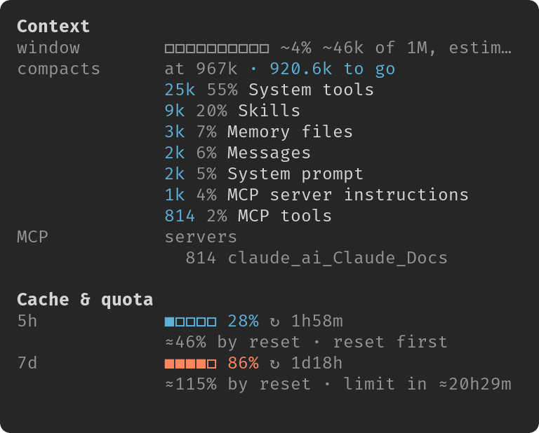

# tidemark

Полоса виджетов над промптом Claude Code, в терминале и в десктопном приложении.

- насколько заполнен контекст и когда истечёт кеш промпта
- квоты на 5 часов и неделю со временем до сброса
- модель, уровень рассуждений (effort) и ветка git
- нажатие на виджет переключает модель или effort, открывает `/usage` или `/context`, запускает `/compact`
- `/tidemark` показывает, чем занят контекст и когда кончится квота
- `/tidemark-config` правит полосу с живым превью и пресетами
- у десктопного приложения может быть своя раскладка полосы
- работает рядом с вашим `statusLine`, настройки не меняет; телеметрии нет

Нужен Claude Code 2.1.288 или новее.

```
/plugin marketplace add VizzleTF/claude-skills
/plugin install tidemark@vizzletf-skills
```

Полоса появится сразу после установки. Если её нет, выполните `/reload-plugins`.


## Содержание

- [Команды](#команды)
- [Виджеты](#виджеты)
- [Настройка](#настройка)
- [Удаление](#удаление)
- [Что он запускает, читает и пишет](#что-он-запускает-читает-и-пишет)
- [Ссылки](#ссылки)

## Команды

| Команда | Открывает |
|---|---|
| `/tidemark` | Панель деталей: контекст по источникам, кеш и квоты с прогнозом до сброса, сессия и её сабагенты |
| `/tidemark-config` | Редактор конфига с живым превью |
| `/tidemark-goal [текст]` | Задаёт цель сессии для виджета `goal` |
| `/tidemark-project [текст]` | Задаёт имя проекта для виджета `project` |



## Виджеты

Колонка **По умолчанию** отмечает виджеты полосы, которая действует без файла конфига. Часть из них скрыта, пока им нечего показать.

| Виджет | Показывает | По умолчанию |
|---|---|---|
| `context` | бар `ctx`, процент, `used/window`, спарклайн роста | ✓ |
| `cache` | `warm 38m`, `cold`, `rewrote 45k` | ✓ |
| `quota5h` | `5h 42% ↻ 2h34m` | ✓ |
| `quota7d` | `7d 63% ↻ 2d7h` | ✓ |
| `model` | `opus 5.5 · high`; нажатие переключает модель или effort | ✓ |
| `git` | ветка, `*` при незакоммиченных правках, синхронизация с upstream, `+12 −3` | ✓ |
| `goal` | текст из `/tidemark-goal`; скрыт, пока не задан | |
| `project` | текст из `/tidemark-project`; скрыт, пока не задан | ✓ |
| `compact` | кнопка `/compact` | ✓ |
| `actions` | кнопка `⚙`, открывает `/tidemark-config` | ✓ |
| `flex` | ничего; делит строку на группы: слева, посередине, справа | ✓ |
| `cost` | `≈$1.84 (+$0.12)`: сессия и текущий ход | |
| `agents` | спиннер на каждого работающего сабагента | |
| `cwd` | имя проекта, имя каталога или путь | ✓ |
| `sessionTime` | `⏱ 1h12m` с начала разговора | ✓ |
| `compactions` | `⇣2` | |
| `tokenSpeed` | `42 t/s` за последний ход | |
| `command` | первая строка вывода вашей команды | |
| `claudeStatus` | от `● ok` до `● critical` со status.claude.com | |
| `gitPr` | `#123 ✓` для PR или MR ветки; нужен `gh` или `glab` | |

Кеш промпта хранит разговор 5 минут или час после каждого запроса. `warm 38m` показывает, сколько осталось; после этого следующий запрос `cold`: он заново пишет в кеш весь контекст, а это дороже. Знак `◆` после процента квоты значит, что вы тратите её быстрее, чем идёт её окно.

Полоса по умолчанию использует значки Nerd Font; если такого шрифта в терминале нет, поставьте `style.icons` в `text`. Приложение Claude Desktop рисует текстовые метки, и у него может быть своя полоса: ключ `desktop` в [справочнике](docs/reference.ru.md#ключи-конфига). Цифры окрашены от синего к красному по израсходованной доле. Опции каждого виджета описаны в [справочнике](docs/reference.ru.md#виджеты).

## Настройка

Файл конфига не нужен. Чтобы изменить виджеты, запустите `/tidemark-config`, поправьте полосу в превью, выберите файл в поле `save to` и нажмите `Save`:

| `save to` | Файл |
|---|---|
| `global` | `~/.config/tidemark/config.json` |
| `project` | `.claude/tidemark.json` в каталоге сессии; перекрывает `global` |

В редакторе есть и пресеты: `minimal`, `classic`, `default`, `full` (две строки) и `powerline`. Когда контекст займёт 70% окна, под полосой появится кнопка `/compact`; порог задаёт `compact.at`.

## Удаление

```
/plugin uninstall tidemark@vizzletf-skills
```

Файлы конфига и заметки проекта остаются. Чтобы убрать и их, удалите `~/.config/tidemark/`, `.claude/tidemark.json` и `.claude/tidemark-project.txt`.

## Что он запускает, читает и пишет

tidemark — мод, то есть плагин, который рисует в интерфейсе Claude Code через его API плагинов. Сам Claude Code он не патчит. С виджетами по умолчанию в сеть ходит только `git fetch` раз в 5 минут для виджета `git`; его выключает `git.fetch: 0`.

У tidemark нет телеметрии, автору он ничего не отправляет. Настройки Claude Code и режим разрешений он не меняет.

### Хуки

| Хук | Что делает |
|---|---|
| События сессии: старт, каждый ход и запрос к модели, замеры расхода, компакт, запуск сабагентов, смена модели, отправка промпта | Читает, что произошло, чтобы полоса была актуальной, и передаёт событие дальше без изменений |
| Изменения `theme` и `autoCompact` в `/config` | То же |
| Встроенные команды `/clear`, `/resume`, `/branch`, `/model`, `/autocompact`, `/theme`, `/effort` | То же |
| `command.describe` на `/effort` | Читает подсказку аргументов команды |
| `command.run` на `/tidemark`, `/tidemark-config`, `/tidemark-goal`, `/tidemark-project` | Отвечает на четыре команды, которые добавляет мод |
| `ui.render` | Рисует полосу и четыре панели |

Только по нажатию на виджет полосы tidemark запускает встроенную команду этого виджета: `/context`, `/usage`, `/model`, `/effort` или `/compact`.

### Программы

Каждая запускается в каталоге сессии.

| Программа | Зачем | Когда |
|---|---|---|
| `git status`, `git diff --numstat HEAD` | ветка, изменения и размер diff для виджета `git`; fsmonitor и хуки репозитория для этих запусков выключены | после каждого хода, не чаще раза в 5 секунд |
| `git fetch --quiet --no-tags` | сколько коммитов впереди и позади; обращается к вашему remote | раз в 5 минут; `git.fetch: 0` выключает |
| `git rev-parse --show-toplevel` | имя проекта для `cwd` со `style: "project"` | не чаще раза в минуту |
| `git remote get-url origin`, затем `gh pr view` или `glab mr view` | pull request ветки для `gitPr`; обращается к `github.com`, `gitlab.com` или хосту из глобального конфига с логином самих этих утилит | когда прошёл его `ttl` |
| `sh -c <command>` | виджет `command` запускает команду, которую вы задали в глобальном конфиге, и ничего больше; проектный файл её задать не может | когда прошёл его `ttl` |

### Сеть

Кроме программ выше tidemark делает сам один запрос: HTTPS GET `https://status.claude.com/api/v2/summary.json` для виджета `claudeStatus`, по умолчанию выключенного.

### Файлы и настройки

| Что | Хранит | Читает | Пишет |
|---|---|---|---|
| `~/.config/tidemark/config.json`, под `$XDG_CONFIG_HOME`, если задан | глобальный конфиг | ✓ | по `Save` в `/tidemark-config` |
| `.claude/tidemark.json` | конфиг проекта | ✓ | по `Save` в `/tidemark-config` |
| `.claude/tidemark-project.txt` | имя проекта | ✓ | по `/tidemark-project` |
| Хранилище плагина | последняя квота, уровни effort, которые приняла каждая модель, цели недавних сессий | ✓ | по ходу сессии |
| `HOME`, `XDG_CONFIG_HOME` | где лежит глобальный конфиг | ✓ | |
| `CLAUDE_CODE_PROMPT_CACHE_TTL`, `ENABLE_PROMPT_CACHING_1H`, `FORCE_PROMPT_CACHING_5M`, настройка `promptCacheTtl` | время жизни кеша промпта | ✓ | |

Файлы в `.claude` принадлежат tidemark; это не настройки и не инструкции Claude Code. Подробности: [Privacy](PRIVACY.md) (на английском) и [Внешние запуски](docs/reference.ru.md#внешние-запуски).

## Ссылки

- [Приватность](PRIVACY.md): что мод читает, пишет и отправляет (на английском)
- [Справочник](docs/reference.ru.md): опции виджетов, ключи конфига, пресеты, алерты, кнопка компакта, неполадки
- [Решения](docs/adr/) и [Changelog](CHANGELOG.md) (на английском), [README in English](README.md)
- [Все плагины маркетплейса](../../README.ru.md)
- Inspired by [ccOverhead](https://github.com/shengyy/ccoverhead) and [ccstatusline](https://github.com/sirmalloc/ccstatusline); что заимствовано, сказано в [NOTICE.md](NOTICE.md)
